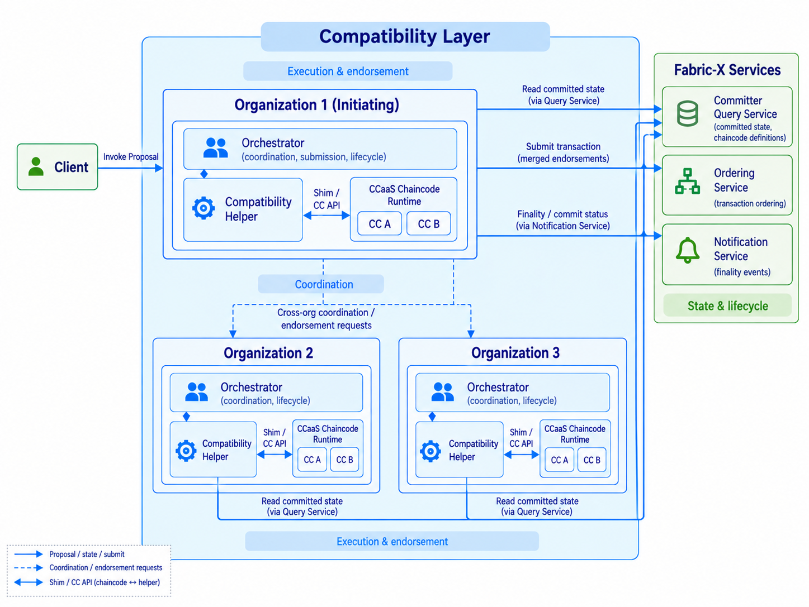

- Feature Name: Fabric-X Chaincode Compatibility
- Start Date: 2026-10-14
- RFC PR:
- Fabric-X Component: fabric-x-chaincode-compatibility
- Fabric-X Issue:

# Summary
[summary]: #summary

This proposal introduces an incremental compatibility layer that enables existing Hyperledger Fabric chaincodes using supported shim APIs to run on Fabric-X without modifying their business logic. It provides an execution environment that translates Fabric chaincode operations into Fabric-X transactions, while supporting multi-organization endorsement, chaincode lifecycle management, and pluggable orchestrator discovery. The goal is to simplify migration from Fabric to Fabric-X while preserving the existing chaincode programming model.

# Motivation
[motivation]: #motivation

Fabric-X introduces a modular transaction processing architecture designed for improved performance and scalability. However, unlike traditional Hyperledger Fabric, it does not provide a native chaincode execution environment. Organizations with existing Fabric applications therefore face significant migration challenges, as their chaincodes cannot be directly executed on Fabric-X without additional infrastructure or modifications.

The proposed compatibility layer addresses this challenge by enabling existing Fabric chaincodes to execute on Fabric-X with minimal modifications. This allows organizations to preserve their chaincode business logic while adopting Fabric-X's transaction processing model, reducing migration complexity and development effort. The Orchestrator also provides a Fabric Gateway-compatible client interface for evaluation, endorsement, transaction submission, commit status, and chaincode event subscription, alongside support for custom client APIs.

The main objectives are:

- Run existing Go chaincodes using Chaincode-as-a-Service (CCaaS).
- Support multi-organization execution and endorsement.
- Provide Fabric compatible chaincode lifecycle operations.
- Allow pluggable discovery and integration with Fabric-X components.
- Support transaction coordination, duplicate detection, and finality tracking.

Together, these capabilities aim to simplify migration while preserving familiar Fabric workflows and leveraging Fabric-X's transaction processing model.

# Guide-level explanation
[guide-level-explanation]: #guide-level-explanation

The compatibility layer allows developers to reuse existing Fabric chaincodes on Fabric-X while retaining familiar deployment and invocation workflows.

The architecture consists of the following components:

| Component | Responsibility |
|---|---|
| **Orchestrator** | Coordinates execution across organizations, collects endorsements, and submits transactions |
| **Compatibility Helper** | Handles Fabric shim communication and translates chaincode state requests into Fabric-X-compatible operations |
| **Chaincode Service** | Hosts and executes existing Fabric chaincodes as independent CCaaS services |
| **Lifecycle Manager** | Manages chaincode installation, organizational approvals, and committed definitions |
| **Discovery Resolver** | Locates and selects Orchestrator instances through configurable discovery mechanisms |

## Chaincode execution

Consider an existing Fabric application that uses chaincode to manage assets. With the compatibility layer, developers can deploy the same chaincode as an external service and continue invoking its existing functions.

For example, an asset-transfer operation can continue using familiar shim APIs such as `GetState`, `PutState`, and `DelState` to retrieve an asset, change its ownership, and update its state. Developers do not need to rewrite this business logic using Fabric-X-specific transaction APIs.

The compatibility layer handles the underlying interaction with Fabric-X, allowing supported chaincode operations to follow its transaction processing model.

## Multi-organization endorsement

Fabric applications may require multiple organizations to endorse a transaction. The compatibility layer preserves this approach without requiring developers to implement cross-organization execution themselves.

For example, an asset transfer requiring endorsements from Org0 and Org1 can be executed through their respective Orchestrators. The transaction proceeds only when both organizations produce consistent execution results and the required endorsements are obtained. If the results differ, the transaction is rejected.

From the application's perspective, the existing organizational endorsement requirements remain part of the transaction workflow.

## Chaincode lifecycle management

Developers can use familiar lifecycle operations such as `install`, `approveformyorg`, `checkcommitreadiness`, `commit`, and `querycommitted` to manage their chaincodes.

Once a chaincode definition is committed, newly started Orchestrators within the same organization can retrieve the committed chaincode definition without repeating the commitment process. This simplifies chaincode management across multiple instances.

## Lifecycle state and commitment

The Lifecycle Manager maintains organizational approvals in each Orchestrator's instance-local, in-memory store. During `checkcommitreadiness`, the initiating Orchestrator verifies approvals from participating organizations through RPC requests. These approvals are not persisted on the Fabric-X ledger or shared automatically across instances.

Once the required approvals are obtained, the initiating Orchestrator submits the committed chaincode definition as a Fabric-X transaction into a configurable lifecycle namespace (`lifecycle-namespace`, default `0`). Committed definitions are stored as ledger-backed metadata and reconstructed by Orchestrators during startup.

Application namespace creation and endorsement policy configuration remain separate Fabric-X operations. Approval checks are performed by the Lifecycle Manager, while Fabric-X validates the resulting lifecycle transaction according to the lifecycle namespace's policy.

## Orchestrator discovery and availability

Organizations are not restricted to a single Orchestrator instance. Multiple instances can be deployed to distribute workloads and improve service availability.

The compatibility layer provides a pluggable discovery interface that resolves these instances through static configuration or dynamic resolution, allowing multiple instances to be associated with the same organization.

In case of multi-Org Endorsement The initiating Orchestrator selects an instance from the resolved endpoints and forwards the transaction proposal for execution and endorsement. This enables flexible deployment and workload distribution without modifying existing chaincodes or endorsement requirements.

Each Orchestrator also maintains a transaction store that tracks transaction IDs and their execution states. This helps identify repeated requests and prevent unnecessary execution or submission.

# Reference-level explanation
[reference-level-explanation]: #reference-level-explanation

The compatibility layer operates as an external service and integrates with Fabric-X through its existing interfaces and SDK. The initial implementation supports direct key-based state operations without modifying Fabric-X core components. Extending compatibility to additional Fabric chaincode APIs may require general purpose enhancements to Fabric-X services and transaction validation, developed in coordination with the Fabric-X community.

## Architectural overview

The architecture separates chaincode execution from Fabric-X transaction processing. Each Orchestrator contains an embedded compatibility helper that implements the Fabric chaincode shim communication protocol and communicates with external Chaincode-as-a-Service (CCaaS) runtimes.

The design separates three main responsibilities:

- **Execution and endorsement:** The compatibility helper handles chaincode execution and state operations, producing results for endorsement.
- **Coordination:** Orchestrators coordinate execution across organizations, collect endorsements, and manage transaction submission and finality.
- **Discovery and transaction coordination:** Orchestrators resolve instances through configurable discovery mechanisms and track transaction progress locally to identify duplicate requests and manage execution states.

This separation allows the compatibility layer to reuse existing Fabric chaincode execution mechanisms without introducing the traditional Fabric peer architecture into Fabric-X core components.

## Execution and endorsement

When an Orchestrator receives a transaction proposal, it resolves the corresponding chaincode runtime and invokes it through the embedded compatibility helper.

The Orchestrator exposes a Fabric Gateway-compatible client interface supporting `Evaluate`, `Endorse`, `Submit`, `CommitStatus`, and `ChaincodeEvents`. `Evaluate` executes chaincode without submitting a transaction, while `Endorse` collects the required endorsements, `Submit` forwards the signed transaction for ordering, and `CommitStatus` retrieves its final outcome through the Notification Service. `ChaincodeEvents` allows clients to subscribe to committed chaincode events.

The helper processes Fabric shim messages and translates state requests into operations supported by Fabric-X. Direct key-based reads are retrieved from committed state through the Committer Query Service, recording each key's version or absence in the transaction's read set for MVCC validation. Writes and deletions are collected in the transaction's write set without modifying committed ledger state. Subsequent reads continue to retrieve committed values rather than the transaction's pending writes, preserving Fabric's execution semantics.

For multi-organization endorsement, the initiating Orchestrator resolves the required organizations and requests independent execution through their respective Orchestrators. The resulting execution responses and read-write sets are compared for consistency before endorsements are combined. Any disagreement prevents the transaction from proceeding to submission.

Each organization signs the Fabric-X namespace transaction contents, including the transaction ID, namespace information, read-write set, and transaction metadata. The chaincode response payload is included in the signed metadata, while response status and message are compared separately before endorsement aggregation.

The Fabric-X SDK provides reusable functionality for transaction construction, identity handling, and interaction with Fabric-X services. The resulting transaction is submitted to the Ordering Service, while its commit status is observed through the Notification Service.

Chaincode events generated through `SetEvent` are included in the endorsed transaction metadata using the Fabric-X SDK. The event name and payload are encoded using the SDK's `metadatapb.Metadata` structure, which defines `event_name` and `event`, and are stored in `applicationpb.Tx.Metadata[0]` following the SDK's existing convention. The metadata index is currently not configurable in the compatibility layer, and potential conflicts with other metadata consumers require consideration. After receiving `COMMITTED` finality, the Orchestrator returns the event in the invocation response. Clients can also subscribe to committed chaincode events through the Fabric Gateway-compatible `ChaincodeEvents` interface, implemented using Fabric-X's committed-block services.

## Coordination

The initiating Orchestrator coordinates transaction execution and endorsement across participating organizations. It identifies the required organizations and resolves their Orchestrator instances through the discovery interface.

Inter-Orchestrator communication supports configurable mutually authenticated TLS (mTLS). Each participating Orchestrator independently verifies the original client's proposal signature, MSP identity, and invocation permissions against configured trust and authorization policies before execution and endorsement. These checks operate independently of endpoint discovery.

Each participating Orchestrator independently executes the chaincode against committed state obtained through its Query Service and returns its execution response, read-write set, and endorsement. The initiating Orchestrator compares these results and combines endorsements only when they agree; otherwise, submission is aborted. The compatibility layer does not enforce shared ledger snapshots across organizations, leaving final transaction validation and commitment to Fabric-X.

Once the endorsements are collected, the initiating Orchestrator constructs the Fabric-X transaction using the SDK and submits it to the Ordering Service. The transaction's final outcome is then observed through the Notification Service.

Endorsement requirements are configured as Fabric-X namespace policies, using Fabric's `SignaturePolicyEnvelope` representation within `NamespacePolicy.msp_rule`. This supports organization-level `AND`, `OR`, and `OutOf` policies. The initiating Orchestrator interprets these policies to coordinate execution and collect endorsements, while Fabric-X verifies endorsement signatures and enforces the namespace policy during transaction validation. Namespace policies are configured separately from chaincode lifecycle definitions.

Throughout this process, the Orchestrator maintains transaction progress in a local store to identify duplicate requests and track execution, submission, and finality.

## Discovery and transaction coordination

The discovery interface supports both statically configured endpoints and dynamic resolution of Orchestrator instances. Each organization can be associated with multiple endpoints, and resolved connections can be cached for subsequent requests.

This allows an Orchestrator to select among available instances when coordinating execution with other organizations. Endpoint selection, load balancing, and failover strategies can evolve independently of the chaincode execution logic.

To reduce redundant processing, the Orchestrator maintains a transaction store with the following states:

- `IN_PROGRESS`: Transaction execution has started.
- `EXECUTED`: Execution results have been collected.
- `SUBMITTED`: Transaction has been submitted for ordering.
- `COMPLETED`: A final transaction outcome has been observed.

These states help identify repeated requests and track execution progress. Additional recovery and synchronization mechanisms may be required when multiple Orchestrators process transactions concurrently or restart during execution.

If an Orchestrator or Query Service times out, requests may be redirected to another instance, subject to transaction recovery and consistency requirements. If required endorsements cannot be obtained, submission is aborted. Transaction IDs identify client retries to prevent duplicate processing. Submitted transactions without finality notifications remain SUBMITTED until their outcome is confirmed, without automatic re-submission.

## Trust assumptions

The proposed compatibility layer operates under the following assumptions:

- **Organizational ownership and trust:** Each participating organization independently operates and trusts its own Orchestrator instances and chaincode execution environment. Organizations recognize each other's identities through configured Membership Service Providers (MSPs) and trusted certificate authorities.

- **Client interaction:** Clients may use the Fabric Gateway SDK or a custom client to interact with the compatibility layer. Requests are typically directed to the client's own organization's Orchestrator, although other authorized Orchestrators may also be used.

- **Multi-organization endorsement:** Participating organizations are assumed to maintain trusted chaincode execution environments and protect their endorsement credentials. The initiating Orchestrator independently verifies endorsement identities, signatures, and execution consistency against the configured namespace policy.

- **Communication and discovery:** Orchestrators rely on authenticated communication channels, such as TLS/mTLS, and configured discovery mechanisms to locate participating instances. Resolved endpoints are not implicitly trusted without identity verification.

- **Fabric-X services:** The compatibility layer relies on Fabric-X for committed-state queries, transaction ordering, endorsement-policy enforcement, MVCC validation, and transaction finality.

## Compatibility limitations

- **State operations:** The initial implementation supports direct key-based `GetState`, `PutState`, and `DelState` operations, including exact composite keys.
- **Range queries and iterators:** Public range queries, partial composite-key scans, and pagination are not yet supported. Extending these operations requires Query Service integration, iterator handling, and appropriate validation of range-query dependencies.
- **Advanced queries:** Rich queries and history queries remain unsupported. Rich-query support may build on public state enumeration but requires additional query evaluation.
- **Private data:** Private data collections and their associated chaincode APIs are not supported.
- **State-based endorsement:** Per-key endorsement policies and validation-parameter APIs are not supported; endorsement currently operates at the Fabric-X namespace level.
- **Event-only transactions:** Chaincode events are supported for committed write transactions. Transactions containing events but no state writes are currently rejected by the Fabric-X Committer.
- **Chaincode runtime:** The initial implementation supports Go chaincodes deployed as external Chaincode-as-a-Service (CCaaS) runtimes.

### Fabric shim API support

The following table summarizes the Fabric shim APIs supported by the current Go CCaaS implementation.

| Shim API | Current status |
|---|---|
| `GetState`, `PutState`, `DelState` | Supported |
| `GetArgs`, `GetStringArgs`, `GetFunctionAndParameters`, `GetArgsSlice` | Supported |
| `GetTxID`, `GetChannelID`, `GetTxTimestamp` | Supported |
| `GetCreator`, `GetTransient`, `GetSignedProposal`, `GetBinding`, `GetDecorations` | Supported |
| `CreateCompositeKey`, `SplitCompositeKey` | Supported for direct key operations |
| `SetEvent` | Supported |
| Range queries, partial composite-key queries, and pagination | Not supported |
| Rich queries and history queries | Not supported |
| Private data APIs | Outside initial scope  |
| `GetStateValidationParameter`, `SetStateValidationParameter` | Outside initial scope |
| `InvokeChaincode` (chaincode-to-chaincode invocation) | Outside initial scope |

### Fabric Samples compatibility evaluation

The initial implementation was evaluated against 15 Go chaincode modules from Hyperledger Fabric Samples using a two-organization Fabric-X deployment. All 154 public chaincode methods were exercised, with existing business logic preserved and deployment-specific CCaaS adaptations applied where necessary.

| Evaluation metric | Result |
|---|---:|
| Modules demonstrating functional core operations | 10/15 (66.7%) |
| Successfully exercised public methods | 90/154 (58.4%) |
| Modules with all public methods successfully exercised | 2/15 |
| Committed target-chaincode transactions | 55 |

The evaluation demonstrated asset management, attribute-based access control, token operations, chaincode events, multi-organization endorsement, and native MVCC validation. Asset Transfer Events and ERC-20 achieved complete representative method coverage.

The remaining gaps primarily involve range and composite-key scans, rich and historical queries, private data, and state-based endorsement. Five modules could not complete their principal workflows, and nine successful method probes required auxiliary public-state fixtures.

Unsupported operations and additional compatibility features may be addressed in future iterations.

The detailed compatibility matrix and findings are documented in the [Fabric Samples Compatibility Audit](https://docs.google.com/document/d/1Fjy7RK-4PBqFxN_i5f472OddfVTDNQbnms4dwEyg6bs/edit?usp=sharing), evaluated against Fabric Samples revision `5789681b4f4d` and compatibility prototype revision `e8b67f60a3e2`.

For further architectural details and implementation considerations, see the [Compatibility Layer Design Document](https://docs.google.com/document/d/1eseyFreUHmNmviQoq8qYGqatzMXgYZb79CFnlk6kBqg/edit?tab=t.0) (working draft).

# Drawbacks
[drawbacks]: #drawbacks

- **Communication overhead:** Additional chaincode execution and cross-organization communication are expected to increase transaction latency compared with native Fabric-X applications. The extent of this overhead will be evaluated through comparative latency and throughput benchmarks under equivalent workloads.
- **Runtime dependency:** The initial implementation supports only Chaincode-as-a-Service (CCaaS), requiring chaincodes to run as external services.
- **Maintenance overhead:** Maintaining compatibility with Fabric chaincode protocols introduces ongoing maintenance requirements.
- **Feature limitations:** Private data collections, advanced queries, and other unsupported Fabric operations require additional functionality or architectural changes.

# Rationale and alternatives
[alternatives]: #alternatives

- An alternative is to rewrite existing chaincodes as native Fabric-X applications. While this offers flexibility, it imposes significant migration costs.

- Another approach would be to integrate chaincode execution directly into Fabric-X core components. However, this would introduce a dependency on the traditional Fabric execution model.
  
- A third approach would be to adapt existing Fabric peers to execute chaincodes and interface with Fabric-X services. However, this would require maintaining additional peer infrastructure and adapting its transaction processing model.

The proposed approach keeps chaincode execution separate from Fabric-X, allowing existing applications to migrate while preserving the modular architecture of Fabric-X.

# Prior art
[prior-art]: #prior-art

- [Fabric Chaincode-as-a-Service](https://hyperledger-fabric.readthedocs.io/en/latest/cc_service.html) demonstrates how chaincode execution can be separated from the Fabric peer process. This proposal builds on that model while adapting chaincode execution to Fabric-X's transaction processing architecture.
- [Fabric Smart Client](https://github.com/hyperledger-labs/fabric-smart-client) provides a model for coordinating distributed transaction execution. The compatibility layer follows a different approach, focusing specifically on preserving Fabric chaincode execution and endorsement workflows.
- The [Fabric-X SDK](https://github.com/hyperledger/fabric-x-sdk) proposal introduces reusable building blocks for custom endorsers and identifies chaincode compatibility as an intended application. The compatibility layer builds on these components to provide a dedicated execution and coordination environment for existing Fabric chaincodes.

# Testing
[testing]: #testing

Beyond standard unit tests for individual components such as the Orchestrator, compatibility helper, and lifecycle manager, validation of this proposal includes integration testing and compatibility evaluation against existing Hyperledger Fabric chaincodes.

An initial evaluation against Hyperledger Fabric Samples has established a baseline of supported operations and identified the principal compatibility gaps. Further validation will follow three complementary strategies:

1. **Chaincode Compatibility and Differential Testing:** The initial evaluation exercised 154 public methods across 15 Go chaincode modules on a two-organization Fabric-X deployment. Successful transactions were verified against committed ledger outcomes, including multi-organization endorsement, chaincode events, and MVCC validation. Further testing will compare representative chaincodes on traditional Hyperledger Fabric and Fabric-X using equivalent inputs and expected outcomes. Operations such as `GetAllAssets`, which depend on `GetStateByRange`, will be retested once range-query support becomes available.

2. **Lifecycle and Orchestrator Integration:** Test chaincode installation, organizational approvals, and ledger-backed definitions across multiple Orchestrators. Verify that newly started instances can reconstruct lifecycle state, discover other Orchestrators, and handle duplicate requests and transaction finality correctly.

3. **Performance Evaluation:** Compare transaction latency and throughput between native Fabric-X applications and the compatibility layer under equivalent workloads. Measure end-to-end transaction latency, including commit finality, and sustained throughput for single-organization and multi-organization execution.

Further testing will address differential compatibility, recovery, and failure scenarios to evaluate the reliability of the proposed migration approach.

# Dependencies
[dependencies]: #dependencies

The compatibility layer depends on:

- Fabric chaincode shim and protobuf definitions.
- Fabric-X SDK for transaction construction, identity handling, and interaction with Fabric-X services.
- Fabric-X Committer Query Service.
- Fabric-X Ordering and Notification Services.
- gRPC for orchestrator and chaincode communication.

Additional Query Service and Validator-Committer capabilities will be required for complete range-query support and phantom-read validation.

# Unresolved questions
[unresolved]: #unresolved-questions

- Should Fabric's package and install lifecycle steps be simplified for CCaaS deployments?
- How should range queries and phantom-read validation be supported in Fabric-X?
- What additional coordination is required for reliable transaction recovery across multiple orchestrators?
- Which additional Fabric chaincode APIs should be prioritized for future compatibility?
